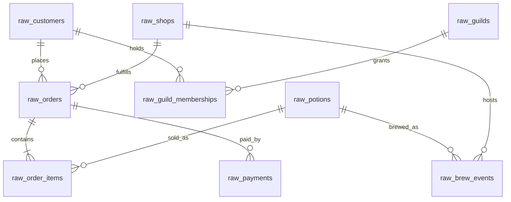

# 🧙‍♀️✨🌿 Merlin & Co. Apothecaries

Welcome! Merlin & Co. Apothecaries is a wizard-themed dbt project for the **Level Up with AI**
workshop. It models a 15-shop potion retailer across sales, customers and guilds, and
brew and shop operations.

The project runs on Snowflake with **dbt v2 Stable**. In this workshop you'll learn
to prompt dbt Wizard to build mart models, review what it produces, and then capture your
team's standards in agent files (an `AGENTS.md` and a reusable skill) so Wizard follows them
on its own. You'll finish by rebuilding the same request in a fresh chat and seeing those
standards pay off.

The loop this workshop teaches: **prompt -> review -> capture -> accelerate.**

## Exercise outcome

Participants create:

1. `models/marts/dim_shops.sql` — one row per shop, built from
   `stg_alembic_ops__shops`.
2. `models/marts/fct_brews.sql` — one row per brew batch, built from
   `stg_alembic_ops__brew_events`.
3. Root `AGENTS.md` — concise always-on project instructions.
4. `.agents/skills/create-mart-model/SKILL.md` — the team's reusable mart workflow.

The starter project includes comment-only placeholders for both agent files. They make the
intended locations visible without supplying modeling guidance before Exercise 3.

## Getting started

1. Open the project in dbt Studio and confirm dbt Wizard is available.
2. Go to [`training_assets/exercises/`](training_assets/exercises/) and open
   [`exercise1.md`](training_assets/exercises/exercise1.md).
3. Work through the exercises in order:
   1. [Build two marts with Wizard](training_assets/exercises/exercise1.md)
   2. [Review the first attempt](training_assets/exercises/exercise2.md)
   3. [Capture the team's standards](training_assets/exercises/exercise3.md)
   4. [Rebuild with agent instructions](training_assets/exercises/exercise4.md)

Project-specific review criteria live in
[team notes](training_assets/exercises/team_notes.md). After drafting the agent files,
compare them with the worked examples under [`training_assets/solution/`](training_assets/solution/).

## Repository map

```text
.
├── AGENTS.md                          # Exercise 3 placeholder for always-on context
├── SECURITY.md                        # non-negotiable data and action boundaries
├── .agents/skills/create-mart-model/  # Exercise 3 skill placeholder
├── models/
│   ├── staging/                       # source-facing cleanup views
│   ├── intermediate/                  # joins and grain changes
│   └── marts/                         # contracted dimensions, facts, and semantics
├── macros/                            # shared cleanup and currency macros
├── docs/merlinco/                     # ERD, data dictionary, and style guide
├── seeds/medium_data/                 # portable workshop fixtures
└── training_assets/
    ├── exercises/                     # four-part participant guides and team notes
    ├── solution/                      # model and agent-file examples
    └── reference/                     # approachable org-wide governance examples
```

## Source systems

The 9 raw tables come from three fictional source systems:

| Source | Domain | Raw tables |
|---|---|---|
| **Abracadabra POS** | Point-of-sale: potions, orders, line items, and payments | `raw_potions`, `raw_orders`, `raw_order_items`, `raw_payments` |
| **Grimoire CRM** | Wizards, guilds, and memberships | `raw_customers`, `raw_guilds`, `raw_guild_memberships` |
| **Alembic Ops** | Shops and brewing operations | `raw_shops`, `raw_brew_events` |

Raw relations are pre-built in Snowflake and declared as dbt sources. The committed seeds
in `seeds/medium_data/` are portable facilitator fixtures (~15k orders, ~51k order items,
5k customers). See the [data dictionary](docs/merlinco/DATA_DICTIONARY.md) for per-table
column notes and the deliberate data quirks participants will clean up.

## ERD

See [docs/merlinco/ERD.md](docs/merlinco/ERD.md) for the full schema diagram with columns and
types. Quick relationship overview of the raw sources:



## Downstream models (Kimball)

Built out already vs. what participants build in the exercises:

| Layer | Already built | You build |
|---|---|---|
| staging | `stg_` models for potions, orders, order_items, payments, customers, guilds, guild_memberships, shops, brew_events | |
| intermediate | `int_customers_with_current_membership`, `int_memberships_current`, `int_order_items_with_order_context`, `int_orders_with_payments`, `int_payments_with_order_context` | |
| dims | `dim_wizards`, `dim_potions`, `dim_dates` | `dim_shops` |
| facts | `fct_orders`, `fct_order_items`, `fct_payments` | `fct_brews` |

Staging normalizes the deliberate raw quirks through shared macros (`to_boolean`,
`copper_to_gold`, `conform_region` in [macros/](macros/)) plus direct casts and lightweight
cleanup. Marts carry enforced contracts and tests.

## Built-in storylines

The fixture data has patterns you can find as you explore:

- **Growth**: order volume climbs steadily across the two-year window (2024-07 → 2026-06); the latest half-year has ~70% more orders than the first
- **Seasonality**: Healing potions spike in winter, Love potions roughly double their share in February, and Luck peaks around the new year
- **Regional spread**: revenue varies by shop region, with about a 1.7× gap between the top and bottom regions
- **Whales**: a small group of customers drives outsized revenue, with the top 5% accounting for roughly a quarter of it

## Support

This project is provided as-is for a workshop, without SLAs.
